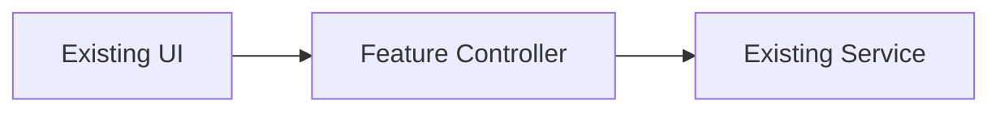
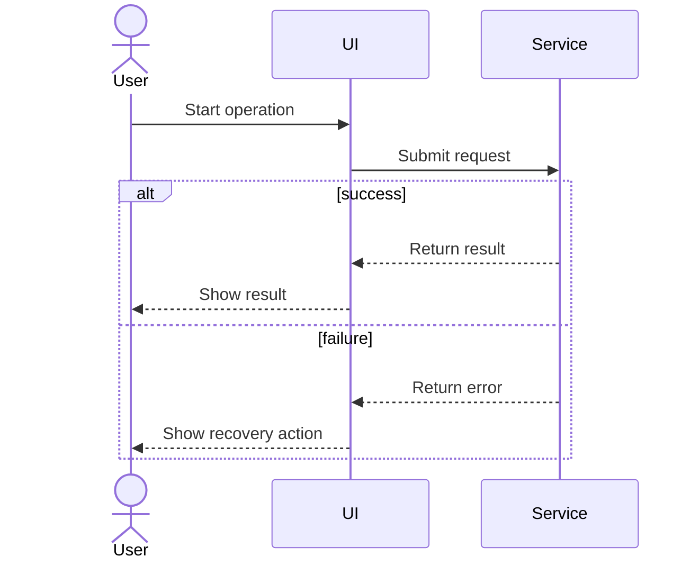

# Architecture — <Feature>

**Status:** Draft.  
**Version and date:** <version and date>.  
**Repository and branch:** <verified repository and branch>.  
**Owner and reviewers:** <verified people or roles>.

> Replace placeholders with full sentences. Use the clear-writing checklist in `references/technical-writing.md`. The reader is a junior engineer who has not worked on this feature.

## 1. Purpose and recommendation

The user needs <capability> because <problem>. I recommend <approach> because <reason grounded in the current application>. The expected result is <observable benefit>.

## 2. Current behavior and requirements

Today, the application <verified behavior>. The source file `<verified path>` shows <what the code does>. The new feature must support <behavior> without changing <existing responsibility>.

- The user must be able to <specific action>.
- The system must complete <operation> within <measurable limit or explicitly unknown target>.
- This release does not include <out-of-scope behavior>.
- The proposed design assumes <assumption>. The team must confirm this before <dependent decision>.

Explain each unfamiliar acronym and project-specific term when it first appears.

## 3. Existing application architecture

The current UI calls <existing component or API>. That component <actual responsibility>. The source of this behavior is `<verified path>`. The feature will reuse <existing integration> instead of introducing <unnecessary new system>.

## 4. Online research and comparable implementations

The following examples show how other systems solve similar problems. Explain which ideas apply to this codebase and which do not. Only include sources that were actually inspected.

| Source and URL | Research date | What the source shows | What this means for the feature |
|---|---|---|---|
| <verified source> | <date> | <complete sentence> | <complete sentence> |

## 5. Options and recommendation

Option A <description in full sentences>. Option B <description in full sentences>. I recommend <option> because <trade-off explained for this repository>.

| Option | Benefits | Trade-offs | Decision |
|---|---|---|---|
| <option> | <complete sentence> | <complete sentence> | <complete sentence> |

## 6. Architecture, components, and interfaces

The following block diagram shows the main parts of the feature and the direction of their requests. Each block must map to a real or explicitly proposed responsibility.

1. The existing UI sends <user request> to the feature controller.
2. The feature controller <specific validation or coordination action>.
3. The existing service <specific responsibility> and returns <result>.

The <component> accepts <input contract> and produces <output contract>. The <owner> is responsible for <state or data>. Describe any storage, concurrency and API compatibility requirements in complete sentences.

## 7. Request sequence and recovery

The following sequence diagram shows how the system completes <main operation>. It also shows what the user sees if the service fails.

1. The user starts <operation> on <screen>.
2. The UI validates <input> and requests <behavior> from the service.
3. On success, the UI shows <expected result>.
4. On failure, the UI explains <specific problem> and offers <recovery action>.

## 8. Security, reliability, and performance

The system checks <authorization condition> before it processes <sensitive action>. The client handles <timeout> by <specific behavior>. The team will measure <metric> to verify <target>.

## 9. UX requirements for mockups

The mockups must show <main screen>, <loading state>, <error state>, and <any other relevant state>. They must use the existing application's typography, colors, themes and shared UI components.

## 10. Test strategy, rollout, and rollback

The team will verify the main flow by <test with observable result>. The release will use <approved rollout approach>. If the feature fails, the team can <explicit rollback action>.

## 11. Risks, open questions, and decisions

The main risk is <specific risk>, which the design mitigates by <action>. The unresolved question is <question with owner>. The recommended option remains provisional until the user approves it.

## 12. Architecture review decision

The architecture is ready for review when all mandatory writing checks pass and at least 80% of applicable readability checks pass. The user can request a revision or explicitly approve the architecture to start mockups.
